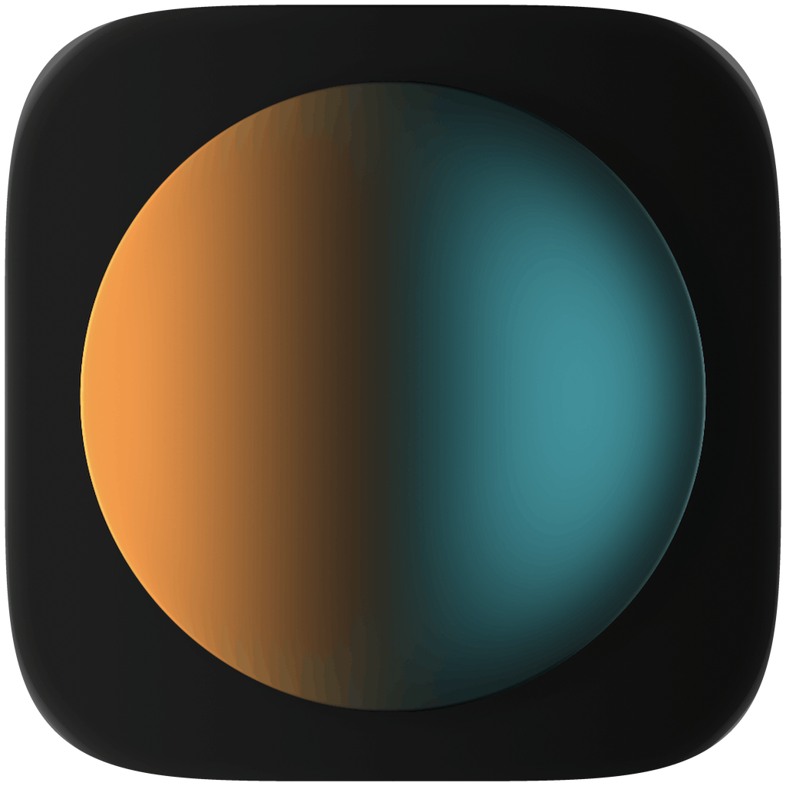

<h1>
  
  Learning Journey
</h1>

Learning Journey is an iOS app that helps you build a daily learning habit. Set a learning goal, log every day you learn, and keep your streak alive, with freezes for the days you can't.

## Main Features

**Set a learning goal**
- On first launch, enter what you want to learn and choose a duration: **Week**, **Month**, or **Year**.
- Change the goal at any time from the Activity screen. A warning alert tells you that updating the goal will restart your streak.

**Track your day on the Activity screen**
- A weekly calendar strip shows the current day and the days you logged or froze.
- Two counters show your current **days learned** (streak) and **days frozen**.
- Tap **Log as Learned** to record today. The button then changes to *Logged as Learned* and can't be pressed again until the next day.

**Freeze a day**
- Tap **Freeze for a day** to protect your streak when you can't learn.
- Freezes are limited by the goal duration: **2 per week**, **8 per month**, or **96 per year**.
- The screen shows how many freezes you've used (for example, "1 out of 2 Freezes used"). When all freezes are used, or the day is already logged, the button is disabled.
- Both buttons become available again at **12 AM**.

**Streak rules**
- The streak resets if more than **32 hours** pass without logging a day as learned or using a freeze.
- The streak also resets when you update your learning goal.
- The text uses "day" for 1 and "days" for any other number.

**Finish a goal**
- When the goal period ends, the app shows **"Well done!"** if you reached it, or **"You didn't reach your goal this time"** if you didn't. From there you can **set a new goal** (or the same one) with one tap.

**Calendar of past days**
- Open the calendar from the Activity screen to see every previous learned day, month by month.
- Learned days are shown in **orange** and frozen days in **blue**. The calendar is view-only.

**Design**
- Dark mode by design, with an orange accent color.
- Custom app icon made in Icon Composer: [view the app icon (PDF)](Images/AppIcon.pdf)

## Architecture

The app follows **MVVM (Model–View–ViewModel)** and is built with **SwiftUI** and the **Observation** framework.

The project is organized into these folders:

```
Challenge_2
├── App             App entry point
├── Models          Data types, e.g. GoalDuration (Week / Month / Year)
├── Resources       Assets and the app icon (LJ_Icon)
├── ViewModels      Screen logic, e.g. LearningGoalViewModel
├── Views
│   ├── Onboarding      First screen: set topic and duration
│   ├── Activity        Daily screen: streak, Log as Learned, Freeze
│   ├── LearningGoal    Edit the goal, with the "Update goal" alert
│   ├── Calendar        View-only history of learned and frozen days
│   ├── Components      Shared UI, e.g. GoalTextField, DurationPicker, UpdateGoalAlert
│   └── Debug           Developer-only helpers for testing
└── Challenge_2Tests    Unit tests
```

### How the layers work together

| Layer | Responsibility | Example |
|---|---|---|
| **Model** | Plain data and rules about a goal and its days | `GoalDuration` |
| **ViewModel** | Holds what the user is entering, decides what is allowed, and talks to the store | `LearningGoalViewModel` only enables **Save** when a topic and a duration are both set, and asks for confirmation before updating |
| **View** | Draws the screen and reacts to taps; contains no business logic | `LearningGoalView` |
| **Store** | One shared source of truth for the goal, streak, freezes, and logged days, injected into the views through the SwiftUI environment | `LearningStore` |

Other design choices:
- **Shared components:** UI used on more than one screen (such as the underlined goal text field) lives in `Components`, so Onboarding and Learning Goal stay consistent.
- **App clock:** time-based rules (the 32-hour streak reset, the 12 AM reset) read the date from `AppClock`, which makes them easy to test.
- **Previews:** every screen has SwiftUI previews for its main states (for example Learning Goal: empty, filled in, and warning alert).

## User Flow


1. **Start learning:** Onboarding → set learning goal and duration → Activity page
2. **Log a day:** Activity page → Log as Learned or Freeze for a day
3. **Set a new goal:** when the goal is completed, Activity page → Set a goal → New learning goal
4. **Change the goal:** Activity page → learning goal icon → change goal or duration → Activity page
5. **See past days:** Activity page → calendar icon → Calendar page

## Built With

- Swift
- SwiftUI
- Observation (`@Observable`)
- Xcode, Icon Composer (app icon)

## Getting Started

1. Clone this repository.
2. Open `Challenge_2.xcodeproj` in Xcode.
3. Select an iPhone simulator and press **Run** (`Cmd + R`).
